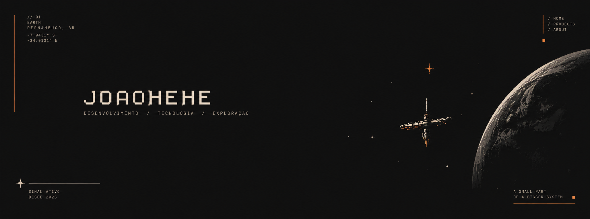

 

 

**Desenvolvedor com foco em Java e desenvolvimento backend.**

Gosto de construir coisas, experimentar ideias e transformar problemas em software.

 

`PERNAMBUCO, BRASIL`　·　`SINAL ATIVO`　·　`DESDE 2026`

---

### Sobre mim

Sou desenvolvedor de software e atualmente estou aprofundando meus conhecimentos em **Java, Spring Boot e desenvolvimento backend**.

Também gosto de explorar outras áreas, criar projetos independentes e experimentar novas tecnologias.

Acredito que aprender também é colocar a mão na massa.

### Projetos selecionados

<table>
<tr>
<td width="50%" valign="top">

<h3>01. Tapefy</h3>

Um player de música para desktop, inspirado na cultura das fitas, pixel art e estética indie.

**Tecnologias:** Electron · React · TypeScript

<a href="https://github.com/JoaoHehe/Tapefy">↗ Acessar projeto</a>

</td>
<td width="50%" valign="top">

<h3>02. Grupo Teatral Cerne</h3>

Portal de notícias com sistema administrativo para publicação e gerenciamento de conteúdo.

**Tecnologias:** Java · Spring Boot · PostgreSQL · Thymeleaf

<a href="https://github.com/JoaoHehe/grupo-cerne">↗ Acessar projeto</a>

</td>
</tr>
</table>

---

### Caixa de ferramentas

**Desenvolvimento**

**Banco de dados e ferramentas**

---

`FIM DO REGISTRO`

ARQUIVO PESSOAL Nº 001 — JOAOHEHE

